<h3><code>pedro@github ~ $ ./contributions.sh</code></h3>

<!-- gráfico de contribuições animado: dados reais, atualizado todo dia por
     .github/workflows/update-profile-art.yml -->

  

<h3><code>pedro@github ~ $ whoami</code></h3>

<!-- retrato ASCII: python scripts/make_ascii_svg.py <foto> ; painel: python scripts/make_info_card.py -->
<table>
<tr>
<td valign="top"></td>
<td valign="top"></td>
</tr>
</table>

<a href="https://www.linkedin.com/in/pedro-luiz-moreira-mariano-001120175/">linkedin</a> &nbsp;/&nbsp; <a href="mailto:pedrolmm123321@gmail.com">email</a> &nbsp;/&nbsp; <a href="https://github.com/pedroluizmm">github</a>

