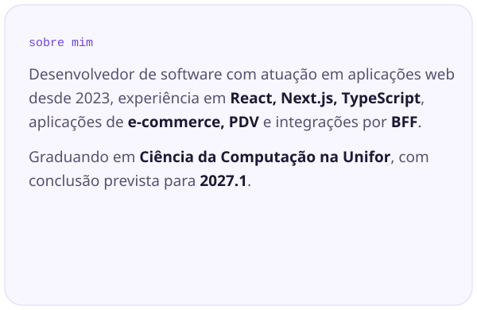
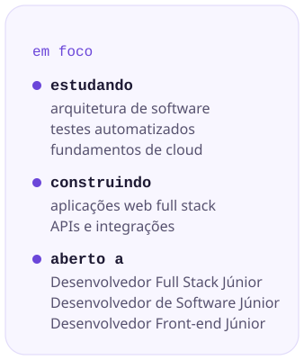
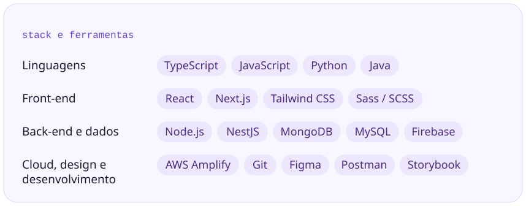
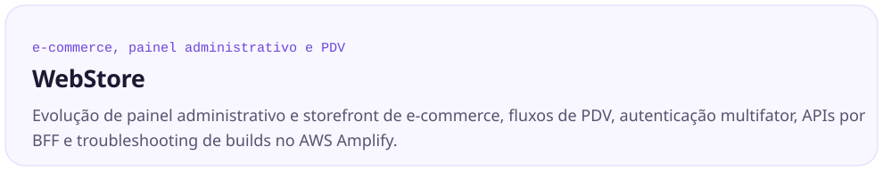
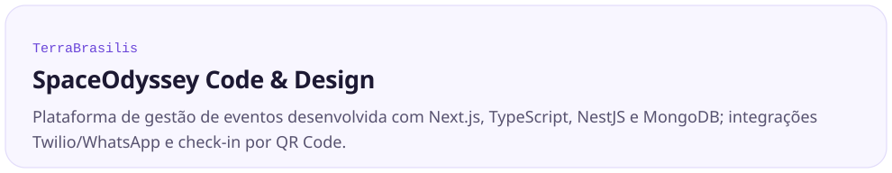
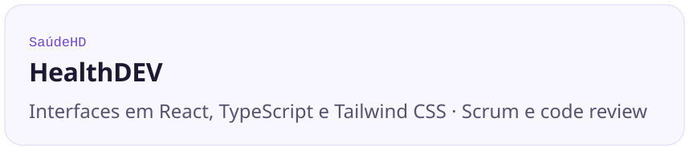

<picture><source media="(prefers-color-scheme: dark)" srcset="https://github.com/pedroluizmm/pedroluizmm/raw/main/assets/bento/hero-dark.svg" /></picture>
<picture><source media="(prefers-color-scheme: dark)" srcset="https://github.com/pedroluizmm/pedroluizmm/raw/main/assets/bento/sobre-dark.svg" /></picture><picture><source media="(prefers-color-scheme: dark)" srcset="https://github.com/pedroluizmm/pedroluizmm/raw/main/assets/bento/foco-dark.svg" /></picture>
<picture><source media="(prefers-color-scheme: dark)" srcset="https://github.com/pedroluizmm/pedroluizmm/raw/main/assets/bento/stack-dark.svg" /></picture>

## Experiência profissional e projetos

Atuo no desenvolvimento de aplicações web desde 2023, com experiência em **interfaces, integrações de APIs, sistemas administrativos e fluxos de negócio**. Abaixo estão as principais contribuições em cada experiência, com foco nas tecnologias utilizadas e nos problemas de produto trabalhados.

### WebStore — E-commerce, painel administrativo e PDV

**Desenvolvedor de Software | Estágio → Desenvolvedor Júnior (PJ) | 2025–2026**

<picture><source media="(prefers-color-scheme: dark)" srcset="https://github.com/pedroluizmm/pedroluizmm/raw/main/assets/bento/exp-webstore-dark.svg" /></picture>

- **Painel administrativo:** desenvolvi e mantive funcionalidades com **Next.js, React e TypeScript** para gestão de **produtos, pedidos, clientes e configurações**, incluindo formulários, filtros, estados de carregamento e upload de imagens.
- **Autenticação e integração:** contribuí com fluxos de **login e autenticação multifator (MFA)**, tratamento de erros e integração entre interfaces e APIs por uma **camada BFF**.
- **Ponto de venda (PDV):** participei do desenvolvimento de fluxos de **identificação de clientes, carrinho, aplicação de cupons, opções de frete e gerenciamento de pedidos**, com atenção à consistência dos estados da interface.
- **Operações de e-commerce:** implementei correções e melhorias em rotinas de produtos e pedidos, além de ajustes de **responsividade** e usabilidade no storefront.
- **Build, deploy e design:** investiguei falhas de compilação do **Next.js e Storybook** no **AWS Amplify**, trabalhei com configurações de build e variáveis de ambiente e utilizei **Figma** para reproduzir e organizar telas e componentes.

**Tecnologias e práticas:** `TypeScript` · `React` · `Next.js` · `BFF` · `APIs REST` · `styled-components` · `AWS Amplify` · `Storybook` · `Figma`

### SpaceOdyssey Code & Design — TerraBrasilis

**Desenvolvedor Full Stack | 2024–2025**

<picture><source media="(prefers-color-scheme: dark)" srcset="https://github.com/pedroluizmm/pedroluizmm/raw/main/assets/bento/exp-spaceodyssey-dark.svg" /></picture>

No projeto **TerraBrasilis**, trabalhei no desenvolvimento de uma **plataforma de gestão de eventos**, com funcionalidades para organização de eventos, interação com participantes e controle de check-in.

- **Front-end:** prototipei telas no **Figma** e desenvolvi interfaces com **Next.js e TypeScript**, conectando os fluxos de uso às funcionalidades da plataforma.
- **Back-end:** implementei funcionalidades e endpoints com **NestJS (Node.js)**, utilizando **MongoDB** para persistência de dados.
- **Comunicação:** integrei o envio de mensagens por **WhatsApp via Twilio**, apoiando os fluxos de comunicação com os participantes.
- **Gestão de participantes:** contribuí com os fluxos de eventos e com o **check-in por QR Code**, conectando as etapas de operação da plataforma.

**Tecnologias e práticas:** `Next.js` · `TypeScript` · `NestJS` · `Node.js` · `MongoDB` · `Twilio` · `WhatsApp` · `QR Code` · `Figma`

### HealthDEV — SaúdeHD

**Desenvolvedor Front-end | 2023–2024**

<picture><source media="(prefers-color-scheme: dark)" srcset="https://github.com/pedroluizmm/pedroluizmm/raw/main/assets/bento/exp-healthdev-dark.svg" /></picture>

Na **HealthDEV**, atuei no front-end do **SaúdeHD**, uma aplicação web, com foco em implementação e manutenção de interfaces e colaboração no desenvolvimento do produto.

- Desenvolvi e mantive **telas e componentes** utilizando **React, TypeScript e Tailwind CSS**.
- Trabalhei na **implementação de interfaces** e em ajustes necessários à evolução da aplicação.
- Participei de **sprints Scrum**, utilizando **Git/GitHub**, **pull requests** e **revisão de código** no fluxo colaborativo da equipe.

**Tecnologias e práticas:** `React` · `TypeScript` · `Tailwind CSS` · `Git/GitHub` · `Scrum` · `Code Review`

---

## Tecnologias principais

**Front-end:** React, Next.js, TypeScript, JavaScript, HTML, CSS, Tailwind CSS, Sass/SCSS e styled-components.  
**Back-end e integrações:** Node.js, NestJS, APIs REST, BFF, MongoDB e MySQL.  
**Ferramentas e ambiente:** Git/GitHub, Postman, Figma, Storybook e AWS Amplify.  
**Outros conhecimentos:** Python, Java, Firebase, Jira, Kanban e Scrum.

## Formação e desenvolvimento

**Bacharelado em Ciência da Computação — Universidade de Fortaleza (Unifor)**  
Conclusão prevista: **2027.1**.

**Atualmente estudando:** arquitetura de software, testes automatizados e fundamentos de cloud.

<a href="https://www.linkedin.com/in/pedro-luiz-moreira-mariano-001120175/"><picture><source media="(prefers-color-scheme: dark)" srcset="https://github.com/pedroluizmm/pedroluizmm/raw/main/assets/bento/btn-linkedin-dark.svg" /></picture></a><a href="mailto:pedrolmm123321@gmail.com"><picture><source media="(prefers-color-scheme: dark)" srcset="https://github.com/pedroluizmm/pedroluizmm/raw/main/assets/bento/btn-email-dark.svg" /></picture></a><a href="https://github.com/pedroluizmm"><picture><source media="(prefers-color-scheme: dark)" srcset="https://github.com/pedroluizmm/pedroluizmm/raw/main/assets/bento/btn-github-dark.svg" /></picture></a>

**Vamos conversar sobre desenvolvimento de software.**

